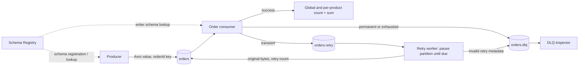

# Kafka Orders With Avro

Python 3.11+, Kafka in KRaft mode (no ZooKeeper), Confluent Schema Registry,
durable retries, a dead-letter queue, and incremental running averages.
Application logs are JSON; the DLQ inspector also renders readable tables.

## Architecture and Layout



```text
.
|-- docker-compose.yml       Kafka, Schema Registry, optional Kafka UI
|-- docker/setup-topics.sh   Idempotent topic creation
|-- schemas/order.avsc       com.assignment.orders.Order
|-- common/                 Settings, JSON logging, Avro and Kafka helpers
|-- producer/main.py         Generation and fault injection
|-- consumer/
|   |-- main.py             Manual-commit consumer loop
|   |-- processing.py       Validation, simulated dependency, aggregate logs
|   |-- averages.py         Count/sum aggregates
|   |-- errors.py           Error classifier
|   |-- headers.py          Retry header validation and replacement
|   |-- retry.py            Backoff and retry/DLQ publication
|   |-- retry_worker.py     Partition-pausing retry scheduler
|   `-- dlq_inspector.py    Decoded records or raw/base64 fallback
|-- tests/                  Unit and isolated Docker Compose integration tests
|-- .env.example
|-- requirements.txt
|-- pyproject.toml
`-- Makefile
```

## Setup From Zero

Install Python 3.11+ and Docker Desktop (or Docker Engine with Compose v2+).
Start Docker and allocate at least 4 GB RAM, preferably 6 GB with the UI.
In the project directory:

```bash
cp .env.example .env
make install
make up
```

`make install` creates `.venv` and installs pinned direct dependencies.
`make up` waits for healthy Kafka/Registry and creates `orders`, `orders.retry`,
and `orders.dlq`, each with three partitions and replication factor one.
Initial image downloads can take several minutes on a slow connection.

Run each of these commands in a **separate terminal** in the project directory:

```bash
make consume
make retry
make produce
make dlq
```

The producer defaults to one order per second. The retry worker must be running
to release scheduled records. Optional UI: run `make ui`, then open
<http://localhost:8080>. Schema Registry: <http://localhost:8081>.
Python uses Kafka at `localhost:9092`; containers use `kafka:29092`.

Ctrl+C or SIGTERM shuts applications down gracefully. `make down` stops
containers but preserves the Kafka volume. These plaintext single-broker
settings are for local demos, not public deployment.

## Interactive Dashboard

```bash
make up
make dashboard
```

Open <http://127.0.0.1:8090>. No Node build or extra Python dependencies are
required. The dashboard uses the actual producer/consumer/retry programs and
reads real Kafka records, not simulated browser data.

1. Click **Start workers** to start the dashboard's consumer and retry worker.
2. Select **Normal orders**, a batch size, and rate, then **Produce orders**.
  Watch acknowledged orders, processed counts, and global/per-product averages.
3. Select **Transient failure / recover**, batch size 1, and two failures.
  Inspect the **Retries** tab, attempt counts, deadlines, and eventual recovery.
4. Select **Invalid data / negative price**, **Missing required product**, or
  **Malformed payload**. Open **Dead letters**, then a record's inspect icon
  for the original payload, error reason, retry count, and provenance headers.
5. Select **Exhaust all retries** to show the configured retry budget ending
  in DLQ. Failed records do not update the averages.
6. Stop the retry worker using its pause icon, produce a transient order, and
  restart the worker. Scheduled records remain in Kafka while it is stopped.
7. Use **Schema registry** for the registered schema and wire format,
  **Event log** for structured application events, and **Consumer offsets**
  for actual committed offsets, log-end offsets, and lag (refreshed about every
  five seconds). Stop the consumer briefly to demonstrate lag increasing.

The continuous switch generates until the producer's stop icon is clicked.
Record search, topic filters, pause/resume display, and JSON export are available.
Pausing the display does not pause processing. Exports use the latest retained
server records with the selected topic/search filters, even when the display
is paused. The browser refreshes every second.

**Isolation and scope:** by default the dashboard creates `demo.orders`,
`demo.orders.retry`, and `demo.orders.dlq`, with separate processing groups.
Existing terminal workers on `orders` are not interrupted or competing consumers.
The dashboard creates missing topics but never deletes them. It binds only to
loopback; this unauthenticated control interface is intended for local demos.
Run one dashboard instance per prefix; a second instance using the same prefix
would split consumption and averages between processes.

`DASHBOARD_PORT` defaults to `8090`; choose another port if occupied.
`DASHBOARD_TOPIC_PREFIX` defaults to `demo.orders`. Other settings, including
retry count and backoff, come from the same environment configuration. Restart
the dashboard after changing them. For a fresh demo, choose a new topic prefix.

Metrics count dashboard-managed events since server startup; aggregate state
resets each time its consumer restarts. The record explorer separately reads
retained Kafka records and keeps the latest 300 in memory. Logs retain 200
events and the chart retains 60 aggregate points. Topic counts in the explorer
describe this retained display window, not broker-wide lifetime totals.
Stopping the server gracefully stops only the subprocesses it owns. Closing
the browser alone does not stop workers or a continuous producer.

Icons are vendored from Lucide 0.468.0 (ISC license, included in the asset).
IBM Plex fonts load from Google Fonts with local font fallbacks; core operation
does not require the font service. Kafka UI remains separately available via
`make ui` at port 8080; the dashboard link uses that default port.

## Live Demo Script

Use one main consumer to demonstrate a single global average. For predictable
counts, use fresh topics. On an existing installation, set three new topic
names and a new consumer group in `.env`, then run `make topics`.

### 1. Start Observers

Terminal A: `make consume`. Terminal B: `make retry`.
Terminal C: `make dlq ARGS="--from-beginning"`. Optionally open Kafka UI.
Run the following producer commands in terminal D; keep A/B/C running.

### 2. Normal Flow

```bash
START_ORDER_ID=1001 make produce ARGS="--count 5"
```

Show `schema_registered` and `order_produced` with Kafka partition and offset.
In terminal A, show `averages_updated`: `summary` displays the global average
and count, followed by each product's average and count. Global `n=5` on a fresh
run. Prices/products are random, so numerical averages vary.

**Explain:** "We retain count and sum, not message history. The order ID key
gives partition affinity while the partition count remains fixed."

### 3. Transient Failure Recovers

```bash
START_ORDER_ID=2001 make produce ARGS="--mode transient --transient-failures 2 --count 1"
START_ORDER_ID=2101 make produce ARGS="--count 2"
```

Terminal A logs `retry_scheduled` with counts 1 then 2; terminal B logs
`retry_released`. The injected order simulates a DB timeout/HTTP 503 twice,
then succeeds on its third processing attempt. Delays are approximately 1 and
2 seconds with jitter. Normal orders continue while it waits. Once all three
succeed, global count is 8. This recoverable order does not enter the DLQ.

**Explain:** "The delayed payload remains in Kafka. The retry worker pauses
only the affected retry partition and continues polling. The main consumer
never sleeps for exponential backoff."

### 4. Permanent Failures Go Straight to DLQ

```bash
START_ORDER_ID=3001 make produce ARGS="--mode negative --count 1"
START_ORDER_ID=3101 make produce ARGS="--mode missing-product --count 1"
START_ORDER_ID=3201 make produce ARGS="--mode malformed --count 1"
```

Terminal C shows three records with `retry-count=0`, original topic/partition/
offset, failure reason, exception type, and UTC timestamp. Negative price is
valid Avro but invalid business data. Missing-product and malformed modes
deliberately bypass the serializer to model broken upstream producers. The
inspector preserves corrupt payloads as raw text plus lossless base64.
Averages remain unchanged because invalid orders never contribute.

**Explain:** "Retrying invalid data cannot repair it. The Avro serializer itself
rejects a missing required product, so that failure demo sends non-Avro JSON."

### 5. Exhaust the Retry Budget

```bash
START_ORDER_ID=4001 make produce ARGS="--mode exhausted --count 1"
```

Observe retry counts 1, 2, and 3 with roughly 1, 2, and 4 second delays, then
a DLQ record with `retry-count=3`. Allow about 10 seconds with default jitter.
That means **one initial attempt plus three retries**. Original source metadata
remains unchanged across topic hops; failed orders do not change the averages.

### 6. Continue Updating Averages

```bash
START_ORDER_ID=5001 PRODUCE_RATE=2 make produce ARGS="--count 4"
```

On a fresh, uninterrupted single-consumer run, global count is now 12.
For continuous mixed traffic:

```bash
START_ORDER_ID=6001 make produce ARGS="--mode mixed"
```

`mixed` cycles normal, transient, exhausted, negative, missing product, and
malformed orders. Stop with Ctrl+C. To demonstrate retry durability, stop
terminal B after `retry_scheduled`, then restart `make retry`: pending records
are fetched again and released, even if their due time has already passed.

## Configuration

All settings load from `.env`; existing shell variables take precedence.
Restart applications after changing settings.

| Environment variable | Default | Purpose |
|---|---|---|
| `KAFKA_BOOTSTRAP_SERVERS` | `localhost:9092` | Client broker list |
| `SCHEMA_REGISTRY_URL` | `http://localhost:8081` | Schema service |
| `ORDERS_TOPIC`, `RETRY_TOPIC`, `DLQ_TOPIC` | `orders`, `orders.retry`, `orders.dlq` | Topic names |
| `CONSUMER_GROUP` | `order-processors` | Main consumer group |
| `RETRY_GROUP` | `order-retry-workers` | Retry worker group |
| `DLQ_GROUP` | `order-dlq-inspector` | Inspector group |
| `TOPIC_PARTITIONS` | `3` | New topic partition count |
| `PRODUCE_RATE` | `1` | Target messages/sec, bounded by acknowledgement throughput |
| `START_ORDER_ID` | `1001` | First sequential ID in this run |
| `MAX_RETRIES` | `3` | Retries after initial attempt; zero disables retries |
| `BACKOFF_BASE_SECONDS` | `1` | Initial base delay |
| `BACKOFF_MAX_SECONDS` | `30` | Maximum delay including jitter |
| `BACKOFF_JITTER` | `0.25` | Symmetric fractional jitter, range 0 to 1 |
| `DELIVERY_TIMEOUT_SECONDS` | `15` | Kafka send timeout, below 120 seconds |
| `POLL_SECONDS` | `0.2` | Poll interval and scheduler precision |
| `LOG_LEVEL` | `INFO` | Log threshold |
| `KAFKA_PORT`, `SCHEMA_REGISTRY_PORT`, `KAFKA_UI_PORT` | `9092`, `8081`, `8080` | Docker host ports |

When changing host ports, update the corresponding client URLs too. Topic setup
is idempotent but does not resize existing topics. IDs are sequential per run;
choose non-overlapping `START_ORDER_ID` ranges across producer runs/processes,
as in the demo. IDs are not persisted or globally allocated.

Producer flags: `--count N` (0 means continuous), `--transient-failures N`, and
`--mode normal|transient|exhausted|negative|missing-product|malformed|mixed`.
Inspector flags: `--count N`, `--from-beginning`. The latter replays on every
assignment, including rebalances; use a separate group for independent auditing.

## Design Decisions

### Avro and Schema Registry

Confluent's `AvroSerializer`/`AvroDeserializer` do the encoding/decoding. Startup
explicitly registers `schemas/order.avsc` under `<orders-topic>-value`; values
use the standard Confluent schema-ID framing. No hand-rolled Avro encoding.
Keys are UTF-8 order IDs. Retries and DLQ records preserve original value bytes,
including the writer schema ID, rather than re-encoding under another subject.

The exact schema is `com.assignment.orders.Order` with `orderId: string`,
`product: string`, `price: float`. Business validation also rejects empty IDs/
products, negative/nonfinite prices, and tombstones. Avro float is 32-bit and
can show binary rounding; real currency applications should prefer integer
minor units or Avro decimal. Readable averages use two decimal places.

### At-Least-Once Delivery

Auto-commit and automatic offset storage are both disabled. The consumer
synchronously commits only the current record after successful processing or
an acknowledged retry/DLQ handoff. Retry forwards are acknowledged before
committing their source record too. Producers use `acks=all` and idempotence
to suppress duplicates caused by producer transport retries.

A crash between processing/publication and commit can replay the record.
Cross-topic publication and commits are not transactional, so **this is not
exactly-once**, and producer idempotence does not close the application-level
gap. Failed destination writes stop processing without committing that source
record. Unknown programming failures and Registry authentication/configuration
errors also stop instead of silently dead-lettering the stream.

SIGINT/SIGTERM set a stop event. Current operations complete within client
timeouts, completed records commit, producers flush, and consumers close.
There is no blanket final commit that could acknowledge pending/prefetched
records. Uncommitted retry records survive shutdown and partition revocation.

### Retry Strategy

Timeouts, connection/transport failures, HTTP 408/429 and 5xx errors are
transient. Invalid data, deserialization failures, malformed retry headers,
and unknown schema IDs are permanent. Unknown schema IDs are considered
unrecoverable in this single-Registry demo; replicated multi-region registries
may need a different policy. Unclassified errors stop without committing.

Missing `retry-count` means zero; invalid/negative counts go to DLQ. Header
updates replace old duplicates. Incoming duplicate headers follow a
last-value-wins rule. Delay for the next retry is:

```text
base = min(max_backoff, initial_backoff * 2 ** (next_retry_count - 1))
delay = min(max_backoff, base * uniform(1 - jitter, 1 + jitter))
retry-at = current Unix timestamp + delay
```

The worker holds at most one pending record per assigned retry partition,
pauses that partition, and continues polling other partitions/group events.
On revocation it discards local pending references without committing them.
Clock synchronization matters because deadlines are wall-clock timestamps.

Compared with in-memory retries, the retry topic survives crashes and keeps
the main consumer available, at the cost of extra traffic, a worker, possible
duplicates, and relaxed ordering. Delayed records block later records in their
**retry partition**, not normal orders. Retries can therefore be late, never
intentionally early. Delay-tier topics or a durable scheduler are alternatives
when retry-partition head-of-line blocking becomes significant.

### Aggregation Scope and Limitations

The consumer keeps one global `(count, sum)` plus one pair per product, using
space proportional to distinct products, not total messages. "Global" means
all successful records **in this process since startup**. Use one main consumer
for this demo; multiple group members maintain independent partial aggregates.
State resets on restart while Kafka offsets persist. Duplicate deliveries can
affect averages. Production durable totals require checkpointed state and
idempotent updates, or a stream processor with transactional state.

### DLQ and Infrastructure

DLQ payloads retain exact original bytes. Headers include `original-topic`,
`original-partition`, `original-offset`, `failure-reason`, `exception-type`,
`retry-count`, and `timestamp` (UTC ISO 8601). Origin metadata survives retries.
An invalid count is normalized to zero in DLQ metadata with the invalid value
recorded in the failure reason. The inspector attempts Avro decoding and falls
back to raw text/base64, including corrupt payloads.

One broker/controller and replication factor one keep the demo small but offer
no broker redundancy. The named volume survives restarts; Kafka retention still
applies. Production needs replication, TLS/authentication, retention planning,
metrics/alerts, durable aggregates, and controlled DLQ replay. Fault-injection
headers are trusted demo inputs and should be removed/restricted in production.

## Tests and Troubleshooting

```bash
make test          # Unit tests, no Docker required
make lint          # Ruff
make integration   # Isolated real Kafka + Registry; cleans up afterward
```

Integration selects temporary host ports and a unique Compose project, creates
topics, exercises real Avro serialization and the real consumer/retry worker,
then checks recovery, exhaustion, immediate DLQ routing, original bytes and
metadata, aggregates, and committed offsets. It removes only its own containers
and volumes. Tests skip integration unless `RUN_INTEGRATION=1` is set.
On a slow first download, run `docker compose pull kafka schema-registry`
before `make integration` to keep downloads outside the fixture's 10-minute
startup deadline.

- Connection problems: `docker compose ps` and
  `docker compose logs kafka schema-registry`; both services must be healthy.
- Port conflicts: change ports and client URLs in `.env`, then restart services.
- With an HTTP proxy, ensure `NO_PROXY` includes `localhost,127.0.0.1`; the
  example environment and integration Make target include this bypass. An
  existing shell `NO_PROXY` overrides `.env`, so update that shell value too.
- Retries accumulate: start `make retry` with matching broker/topic settings.
- Old orders are not replayed: offsets are committed; a new `CONSUMER_GROUP`
  replays retained records, including failures.
- Imports fail: use `.venv` from `make install`, or override `PYTHON` in Make.
- Authlib can emit an upstream HTTPX deprecation warning with these dependencies;
  this is separate from application logs and does not fail the tests.